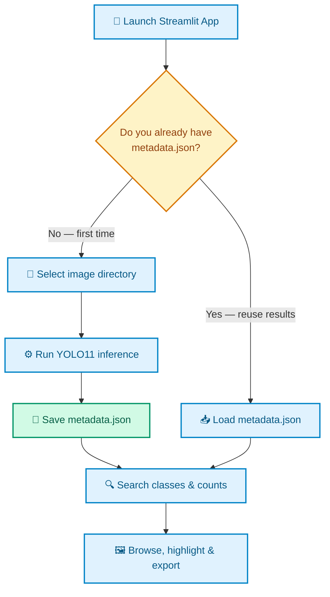
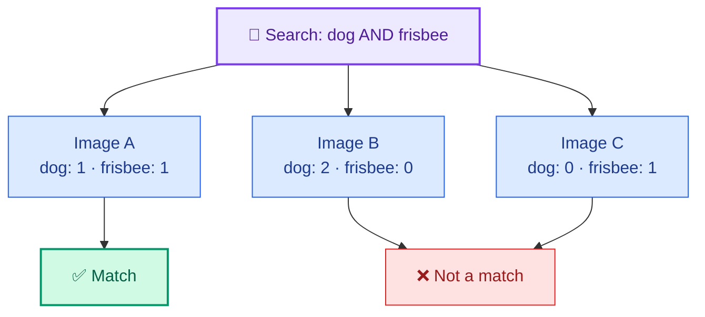
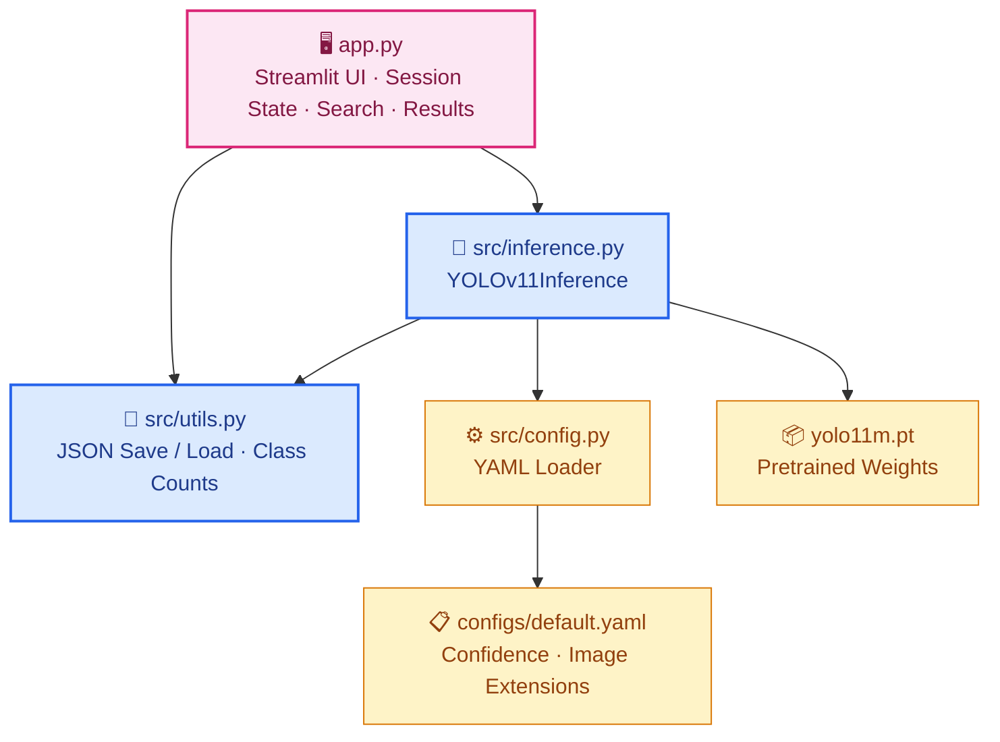

<div align="center">

# 🔎 Visual Image Search Engine

### Search images by what's **inside** them — not by filename.

**YOLO11 · Streamlit · Python · JSON Metadata**


**One-time object detection → reusable metadata → fast, interactive search**

</div>

---

## 🎯 The idea in 15 seconds

Imagine a folder with hundreds of images. Instead of opening them one by one, ask the app:

> **“Show images containing a dog AND a frisbee.”**  
> **“Find a bus OR a bicycle.”**  
> **“Show photos with at most two people.”**

The application first builds a searchable index using a **pretrained YOLO11 object detector**. Then it searches **saved predictions**, so changing search criteria does **not** require rerunning the detector.

## 🗺️ Project workflow — at a glance


**Key architectural decision:** separate **expensive image inference** from **lightweight search on structured metadata**.

### Two ways to use the app



> 🟢 **First run:** detect objects and create the index.  
> 🔵 **Later runs:** load the saved index and search immediately — no new detection run.

---

## ✨ Core capabilities

| | Capability | What it means in practice |
| :---: | --- | --- |
| 🧠 | **Pretrained detection** | YOLO11 predicts object classes, bounding boxes and confidence scores |
| 💾 | **Persistent metadata** | Save image-level detections once and reload them as JSON |
| 🔀 | **Boolean search** | Match **any** selected classes (OR) or **all** selected classes (AND) |
| 🔢 | **Count filters** | Restrict the **maximum number** of a detected class in an image |
| 🖼️ | **Visual inspection** | Display image cards and toggle bounding-box overlays |
| 🎯 | **Match highlighting** | Highlight selected classes or display all predicted boxes |
| 📤 | **Export** | Download matching image records as `search_results.json` |

### 🔎 How search actually works

For every image, Python checks the detected count of each selected class. A class matches only when it is **present at least once**, and its count does not exceed the optional maximum.



| Search | Matches when… |
| --- | --- |
| `dog OR cat` | At least one of the classes is detected |
| `dog AND frisbee` | **Both** classes are detected in the same image |
| `person` + max count `2` | **One or two** people are detected (not zero) |

**Implementation:** `any(class_matches.values())` for OR; `all(class_matches.values())` for AND. This is a **metadata filter**, not another YOLO prediction.

---

## 🧩 Modular software architecture



<details>
<summary><strong>📂 Expand the project folder structure</strong></summary>

```text
Yolo_image_search/
├── app.py                 # Streamlit app, search and visualization
├── src/
│   ├── inference.py       # YOLO model and detection-to-metadata pipeline
│   ├── utils.py           # Save/load JSON and derive search options
│   └── config.py          # Load YAML configuration
├── configs/
│   └── default.yaml       # Confidence threshold and extensions
├── data/                  # Image data / generated metadata
├── test/                  # Streamlit exploration (not automated tests)
├── yolo11m.pt             # Pretrained YOLO11 medium weights
├── requirements.txt
└── instruction.txt
```

</details>

## 🧾 Why JSON is central to the design

The output of YOLO is transformed into a reusable record, rather than being used only to draw a rectangle on one picture.


<details>
<summary><strong>🔍 View a sample metadata record</strong></summary>

```json
{
  "image_path": "data/raw/images/example.jpg",
  "detections": [
    {
      "class": "dog",
      "confidence": 0.94,
      "bbox": [38.0, 51.0, 218.0, 285.0],
      "count": 2
    },
    {
      "class": "dog",
      "confidence": 0.89,
      "bbox": [242.0, 60.0, 411.0, 294.0],
      "count": 2
    }
  ],
  "total_objects": 2,
  "unique_class": ["dog"],
  "class_counts": {"dog": 2}
}
```

*Illustrative record, not a measured output from this repository.* The `count` field on each detection stores the **total count of its class in that image**, while `class_counts` summarizes counts by class. Bounding boxes use pixel-space XYXY coordinates.

</details>

**Important:** the JSON stores **paths to images**, not the image files themselves. Sharing metadata with another machine also requires accessible images and valid paths.

---

## 🚀 Run locally

**1 · Create an environment**

```bash
conda create -n yolo_image_search python=3.11 -y
conda activate yolo_image_search
```

**2 · Install dependencies**

```bash
pip install -r requirements.txt
```

**3 · Start the application**

From the **`Yolo_image_search/`** folder (required by the current relative configuration path):

```bash
streamlit run app.py
```

Open **http://localhost:8501**.

**4 · Choose an entry point**

| 🆕 Process new images | ♻️ Load existing metadata |
| --- | --- |
| Enter image directory and model weights path | Enter existing `metadata.json` path |
| Click **Start Inference** | Click **Load Metadata** |
| Detection runs and metadata is saved | Predictions are reused without inference |

Then select classes, choose OR/AND, optionally set maximum counts, click **Search Images**, adjust display options, and export selected records.

> ⚠️ **Device note:** `src/inference.py` currently defaults to `device='cuda'`. To run new inference on a CPU-only machine, change the default to `device='cpu'`. Reloading existing JSON does not run YOLO. See `instruction.txt` for the original GPU installation guidance.

---

## 🛠️ Technology and implementation details

| Layer | Technology |
| --- | --- |
| Object detection | **Ultralytics YOLO11**, pretrained `yolo11m.pt` |
| Deep learning runtime | **PyTorch** |
| Web application | **Streamlit** |
| Bounding-box visualization | **Pillow (PIL)** |
| Data exchange | **JSON** |
| Configuration | **PyYAML** |
| Implementation | **Python**, separated into UI, inference and utilities |

The current configuration uses **0.30** detection confidence and scans `.jpg`, `.jpeg` and `.png` files in the supplied folder (not recursively).

<details>
<summary><strong>⚙️ Engineering notes and limitations</strong></summary>

- This is a **pretrained inference and search application**, not a YOLO training or fine-tuning project.
- Images are processed individually; no batched/distributed indexing performance is claimed.
- Predicted classes are model-generated labels, **not validated ground truth**.
- The saved `image_path` values must remain resolvable when viewing results.
- Object-count controls are **upper bounds**, not exact counts.
- `test/streamlit_basics.py` is a Streamlit experiment, not an automated integration test suite.
- Exports can support human review and dataset curation, but predicted detections are **pseudo-labels**, not reviewed annotations.

</details>

## 💡 What this project demonstrates

**Model integration** · **structured inference outputs** · **persistent metadata** · **modular Python** · **Boolean retrieval** · **interactive application delivery**

The main takeaway is not only detecting objects. It is building a usable system around model predictions: **index once, search many times, inspect results, and export reusable data**.

---

<div align="center">

Part of [**End2End Computer Vision Project**](https://github.com/MBamdad/End2End_Computer_Vison_Project)

**YOLO11 → JSON → Search → Visualization → Export**

</div>
