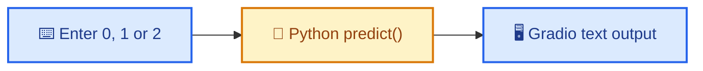
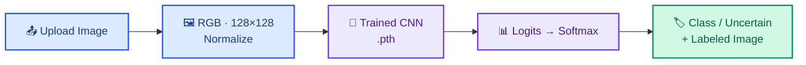
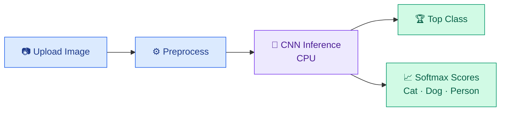
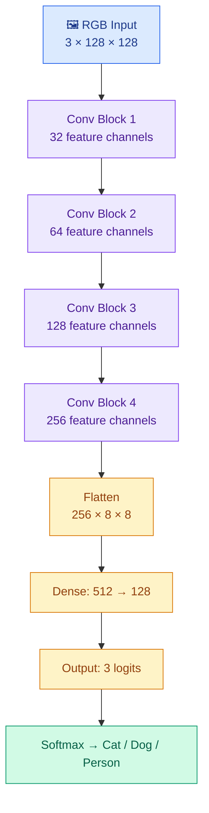
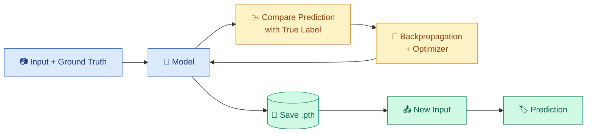

<div align="center">

# 🧠 PyTorch Computer Vision Lab

### From custom CNN training to interactive image-classification applications

**Custom Dataset · PyTorch CNN · Inference Pipeline · Gradio · Streamlit**


**Train a custom three-class CNN → save weights → reuse the model in web interfaces.**

</div>

---

## 🎯 The big picture

This directory explores how to turn a **PyTorch image classifier** into an application that someone else can actually use.

The classification task is **Cat 🐱 / Dog 🐶 / Person 👤**. Rather than treating training and deployment as isolated exercises, the work connects **data preparation**, **network architecture**, **saved model weights**, **inference**, and **user-facing apps**.

## 🗺️ End-to-end learning workflow

```mermaid
flowchart LR
    A["📁 Labeled Images<br/>Custom Dataset"] --> B["🧹 Preprocessing<br/>Resize · Tensor · Normalize"]
    B --> C["🧠 PyTorch CNN<br/>Conv · BN · ReLU · Pool"]
    C --> D["🎯 Training<br/>Loss · Backprop · Optimizer"]
    D --> E[("💾 Model Weights<br/>.pth")]
    E --> F["⚡ Inference<br/>Logits → Softmax"]
    F --> G["🖥️ Gradio / Streamlit<br/>Upload → Prediction"]

    classDef data fill:#DBEAFE,stroke:#2563EB,color:#1E3A8A,stroke-width:2px;
    classDef model fill:#EDE9FE,stroke:#7C3AED,color:#4C1D95,stroke-width:2px;
    classDef train fill:#FEF3C7,stroke:#D97706,color:#92400E,stroke-width:2px;
    classDef saved fill:#D1FAE5,stroke:#059669,color:#065F46,stroke-width:2px;
    classDef app fill:#FCE7F3,stroke:#DB2777,color:#831843,stroke-width:2px;
    class A,B data;
    class C model;
    class D train;
    class E,F saved;
    class G app;
```



> **Key engineering principle:** training is performed separately from serving predictions. Applications reconstruct the same CNN architecture, load the saved `.pth` parameters, switch to evaluation mode, and run inference on uploaded images.

---

## 🧩 Projects in this folder

| Project | Purpose | Does it use a trained CNN? |
| --- | --- | :---: |
| **[01 · Gradio Basics](gradio_app_1/)** | Minimal UI that maps a typed class index to a text label | ❌ |
| **[02 · Gradio CNN Classifier](gradio_app_2/)** | Image upload → PyTorch inference → labeled image | ✅ |
| **[03 · Streamlit CNN Classifier](streamlit_cnn_app/)** | Image upload → prediction + three class scores | ✅ |

### 01 · Gradio Basics — understand the interface



**Goal:** learn the link between a Python function and an interactive web input/output. This is deliberately **rule-based**, not neural-network inference.

**Source:** [`gradio_app_1/app.py`](gradio_app_1/app.py)

### 02 · Gradio CNN Classifier — connect a real model



**Goal:** separate UI code from inference. `app.py` accepts the uploaded image while `core/predict.py` loads the trained CNN, processes it and returns the prediction.

The backend uses **four convolutional blocks**, each with **Conv2d → BatchNorm → ReLU → MaxPool**, followed by fully connected classification layers. It draws the predicted label with OpenCV and returns the result to Gradio.

Its current inference code uses **0.80 as a Softmax threshold** to emit `Uncertain` below that score. This is a simple heuristic, **not a reliable out-of-distribution detector**.

**Explore:** [UI](gradio_app_2/app.py) · [Inference backend](gradio_app_2/core/predict.py) · [Project README](gradio_app_2/README.md)

### 03 · Streamlit CNN Classifier — present predictions clearly



**Goal:** demonstrate the same three-class model concept in a richer application: preview uploads, report the most likely class, show all class scores, and measure inference time. The model weights are cached after the initial load.

**Explore:** [Streamlit app](streamlit_cnn_app/app.py) · [Deployment instructions](streamlit_cnn_app/README.md)

---

## 🔬 The CNN architecture — practical overview



Each block extracts features and halves spatial size through max pooling. The fully connected head combines extracted features into **three class scores**. Softmax converts these logits into relative class probabilities.

**Important:** the classifier predicts **one class for the whole image**. It does **not** locate objects or produce bounding boxes; object detection is covered separately elsewhere in the repository.

---

## 🔁 Training versus inference

| 🏋️ Training | ⚡ Inference |
| --- | --- |
| Labeled images and known targets | A new, unlabeled image |
| Forward pass → loss → backpropagation | Forward pass only |
| Optimizer updates parameters | Parameters stay fixed |
| Save learned parameters to `.pth` | Load the trained `.pth` |
| Typically `model.train()` | `model.eval()` and `torch.no_grad()` / `torch.inference_mode()` |



The deployed Gradio and Streamlit apps perform **inference**, not retraining or transfer learning.

---

## 🗂️ Repository map

```text
PyTorch/
├── README.md                      # This guide
├── gradio_app_1/
│   ├── app.py                     # Rule-based Gradio function demo
│   ├── requirements.txt
│   └── README.md
├── gradio_app_2/
│   ├── app.py                     # Gradio image input / output
│   ├── core/
│   │   └── predict.py            # CNN architecture, weights, inference
│   ├── model/                     # Trained model weights
│   ├── requirements.txt
│   └── README.md
└── streamlit_cnn_app/
    ├── app.py                     # Streamlit interface and inference
    ├── model/                     # Trained model weights
    ├── requirements.txt
    └── README.md
```

*The custom-dataset training notebook is intentionally kept locally rather than tracked in this remote directory.*

## 🚀 Try the apps locally

Run commands from the corresponding app directory. Each app maintains its own dependencies.

| App | Install | Start |
| --- | --- | --- |
| **Gradio basic** | `pip install -r requirements.txt` | `python app.py` |
| **Gradio CNN** | `pip install -r requirements.txt` | `python app.py` |
| **Streamlit CNN** | `pip install -r requirements.txt` | `streamlit run app.py` |

For the Streamlit app, you can alternatively launch from the repository root:

```bash
python -m pip install -r PyTorch/streamlit_cnn_app/requirements.txt
python -m streamlit run PyTorch/streamlit_cnn_app/app.py
```

Keep `cnn_128_model-100.pth` in the application-specific `model/` directory. The Gradio CNN backend automatically selects CUDA if available, otherwise CPU. The Streamlit implementation explicitly loads weights on CPU.

## 🧪 Scope and engineering considerations

- **Demonstrated:** custom CNN architecture, reuse of saved training weights, inference preprocessing, modular prediction code, Gradio and Streamlit user interfaces.
- **Not claimed:** industrial-grade generalization, calibrated probability estimates, robustness to arbitrary out-of-class images, production monitoring, or automated test coverage.
- **Model limitation:** every image is assigned one of three known classes by default; a high Softmax score does **not** prove the image belongs to any of them.
- **Gradio threshold:** the optional `Uncertain` outcome reduces some low-confidence predictions but cannot reliably solve open-set recognition.

---

<div align="center">

### 💡 The engineering takeaway

**A neural network becomes useful when its learned weights can be loaded, evaluated, and integrated into a repeatable user workflow.**

[⬅️ Back to the main Computer Vision repository](../README.md)

</div>
