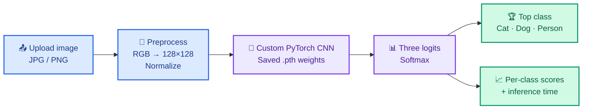
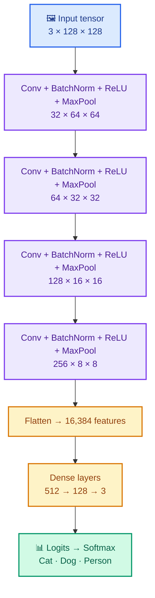
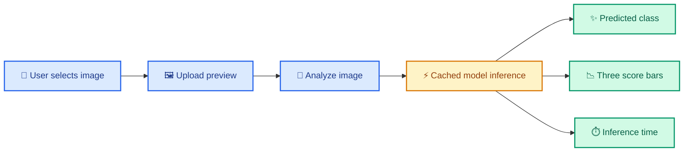

<div align="center">

# 🔎 VisionLab
### Interactive CNN Image Classification with PyTorch & Streamlit

**Upload a photo. Run a trained CNN. Explore the prediction.**


**🐱 Cat &nbsp; · &nbsp; 🐶 Dog &nbsp; · &nbsp; 👤 Person**

[**Explore the app code**](app.py) · [**View model weights**](model/) · [**Back to PyTorch overview**](../README.md)

</div>

---

## 🎯 What does this application do?

**VisionLab** turns a custom-trained **PyTorch convolutional neural network (CNN)** into an accessible, interactive image-classification application.

A user uploads a JPG or PNG image. The backend preprocesses the image, loads previously learned model parameters, runs inference, and returns a **predicted category**, **Softmax scores for all three categories**, and **inference time**.

**The important engineering idea:** the network is **trained separately**; the Streamlit application **reuses the saved weights to make predictions**, without training the model again.

## 🗺️ Application pipeline



| Stage | What happens in the actual code? | Why it matters |
|:---|:---|:---|
| **1 · User interaction** | Streamlit `file_uploader`, image preview, **Analyze image** button | Makes the model usable without writing Python |
| **2 · Preprocessing** | RGB conversion, resize to **128 × 128**, convert to tensor, normalize to **[-1, 1]** | Matches the network's expected input |
| **3 · Model loading** | Recreate the CNN, load `cnn_128_model-100.pth`, call `eval()` | Reuses previously learned weights |
| **4 · Inference** | `torch.inference_mode()` → CNN forward pass | Predicts without gradients or weight updates |
| **5 · Results** | Apply Softmax; display leading class, three scores, and elapsed inference time | Makes results interpretable to the user |

---

## 🧠 Inside the CNN

The model contains **four convolutional feature-extraction blocks** followed by a **fully connected classification head**.



Each convolutional block learns features, and its max-pooling layer halves the spatial dimensions. The last dense layer produces **three raw scores (logits)**. **Softmax** converts these logits into scores that sum to 1 across the three known categories.

> **Task scope:** this is **image classification**, not object detection or segmentation. The output identifies one overall category; the model does not provide bounding boxes or pixel masks.

## 🖥️ How the Streamlit interface works



The app also includes several practical interface behaviors:

- **Model caching:** `@st.cache_resource` avoids reloading weights on every rerun.
- **Input validation:** an unreadable uploaded image produces a user-facing error.
- **Session state:** prediction results persist across Streamlit reruns, and changing the uploaded image clears stale predictions.
- **Performance display:** a timer measures the CNN prediction call.
- **CPU compatibility:** this implementation explicitly loads weights on the CPU, which suits simple hosting.

## 🗂️ Project structure

```text
streamlit_cnn_app/
│
├── app.py                         # Streamlit UI + PyTorch inference
├── model/
│   └── cnn_128_model-100.pth      # Saved trained CNN weights
├── requirements.txt               # App dependencies
└── README.md                      # Architecture + setup guide
```

**Main implementation:** [`app.py`](app.py)

| Code component | Responsibility |
|:---|:---|
| `CustomCnnModel` | Defines the CNN architecture |
| `load_model()` | Loads and caches the trained model |
| `predict()` | Preprocesses the image and produces Softmax scores |
| Streamlit UI code | Uploads, previews, invokes inference and renders results |
| `model/cnn_128_model-100.pth` | Stores the learned model parameters |

---

## 🚀 Run locally

**Recommended Python version:** 3.11.

From the **repository root**, install the app's dependencies:

```bash
python -m pip install -r PyTorch/streamlit_cnn_app/requirements.txt
```

Launch the application:

```bash
python -m streamlit run PyTorch/streamlit_cnn_app/app.py
```

Open the URL shown by Streamlit, typically **http://localhost:8501**.

**Before launching:** verify that `model/cnn_128_model-100.pth` exists inside the app directory. The application resolves this path relative to `app.py`, not your current terminal directory.

## ☁️ Deploy with Streamlit Community Cloud


1. Push the application folder (including its trained `.pth` file) to GitHub.
2. Sign in to [Streamlit Community Cloud](https://share.streamlit.io/) using GitHub.
3. Create a new app from the GitHub repository, using branch **`main`**.
4. Set the main file path to **`PyTorch/streamlit_cnn_app/app.py`**.
5. Select **Python 3.11**, if that setting is available, and deploy.
6. Test the deployed application with an image and check its logs if setup fails.

Community Cloud provides a shareable application URL, subject to its current hosting and resource limits. Repository changes on the configured branch can trigger redeployment.

---

## ⚠️ Model limitations and responsible interpretation

The model only knows **Cat, Dog, and Person**. An unrelated image can still receive a high Softmax score for one of these classes, so the displayed score is **not a calibrated guarantee of correctness**.

This Streamlit implementation reports the top class without an out-of-distribution rejection threshold. Unlike the separate Gradio backend in this repository, it does not currently return an `Uncertain` label.

No production accuracy, robustness, calibration or deployment-performance benchmark is claimed here. Proper validation against unseen and out-of-class images is necessary before using the classifier for consequential decisions.

---

<div align="center">

### 💡 Key engineering takeaway

**A trained model is only one part of an ML solution. This project connects model weights, consistent preprocessing, inference, application state and an interactive web UI into a reusable workflow.**

[**⬅️ PyTorch project overview**](../README.md) · [**⬆️ Main repository**](../../README.md)

</div>
