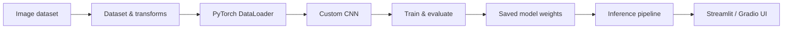

# End-to-End Computer Vision

**Modular CNN Training · Image Classification · Interactive Inference**

    

A computer vision project that connects **data preparation, CNN training, evaluation, model persistence, and inference** in a clear, reusable Python workflow. The repository separates the core PyTorch training pipeline from interactive applications, providing a practical starting point for adapting image classification to new datasets and use cases.

**Current implementation:** a three-class image classifier (**Cat, Dog, Person**) using a custom CNN. The structure is intended to evolve toward application-specific tasks such as industrial visual inspection; such tasks require their own data, training, and validation.

## Workflow



The same image preparation steps are used during training and prediction, keeping model inputs consistent across the workflow.

## Implemented Components

| Component | Implementation |
|---|---|
| **Data loading** | Custom `ImageDataset` with labels derived from class folders; batched loading with PyTorch `DataLoader` |
| **Preprocessing** | RGB images resized to `128 × 128`, converted to tensors, and normalized |
| **Model** | Four CNN blocks: `Conv2d → BatchNorm2d → ReLU → MaxPool2d`, followed by fully connected classification layers |
| **Training** | Cross-entropy loss, Adam optimizer, and CPU/GPU selection |
| **Evaluation** | Accuracy on a separate test split |
| **Model persistence** | Save and reload model weights using PyTorch `.pth` checkpoints |
| **Inference** | Predict the class of an image and create an annotated result |
| **Interfaces** | Streamlit image-upload application and Gradio prediction demo |

## Repository Structure

```text
End2End_Computer_Vison_Project/
├── CNN_Training_Modular/            # Reusable CNN training and prediction pipeline
│   ├── src/
│   │   ├── components/
│   │   │   ├── data_ingestion.py
│   │   │   ├── data_transformation.py
│   │   │   ├── model.py
│   │   │   └── model_trainer.py
│   │   └── pipeline/
│   │       ├── train_pipeline.py
│   │       └── predict_pipeline.py
│   ├── notebook/                    # Exploration and model development
│   └── setup.py
├── PyTorch/
│   ├── 016-CNN-Training-Using-a-Custom-Dataset.ipynb
│   ├── streamlit_cnn_app/            # Interactive CNN web application
│   ├── gradio_app_2/                # CNN inference with Gradio
│   └── gradio_app_1/                # Basic Gradio interface example
├── requirements.txt
└── README.md
```

Explore the implementations: **[Modular CNN pipeline](CNN_Training_Modular/)** · **[Streamlit application](PyTorch/streamlit_cnn_app/)** · **[Gradio inference app](PyTorch/gradio_app_2/)**

## Run the Project

### 1. Set up the environment

```bash
git clone https://github.com/MBamdad/End2End_Computer_Vison_Project.git
cd End2End_Computer_Vison_Project
python -m pip install -r requirements.txt
```

The modular training workflow uses an image dataset with `train` and `test` folders, each containing `Cat`, `Dog`, and `person` subfolders. The images are **not included** in this repository. A dataset link and additional details are available in the [modular pipeline README](CNN_Training_Modular/README.md).

Place the extracted data at `PyTorch/Classification_dataset_v3/images/` before training.

### 2. Train and evaluate the CNN

```bash
cd CNN_Training_Modular
python -m src.pipeline.train_pipeline --epochs 40
```

The pipeline reports training loss and test accuracy, then saves weights to `CNN_Training_Modular/artifacts/cnn_model.pth`.

### 3. Run inference on a new image

From `CNN_Training_Modular/`, after training:

```bash
python -m src.pipeline.predict_pipeline "path/to/image.jpg"
```

The predicted label is printed and an annotated image is saved to `CNN_Training_Modular/artifacts/output_image.jpg`. Replace the example path with an existing image file.

### 4. Launch the Streamlit interface

From the **repository root**:

```bash
python -m pip install -r PyTorch/streamlit_cnn_app/requirements.txt
python -m streamlit run PyTorch/streamlit_cnn_app/app.py
```

The Streamlit application includes trained weights and lets users upload an image, view the predicted class, and inspect scores for all three classes. It is also structured for hosting on [Streamlit Community Cloud](https://streamlit.io/cloud); see the [application README](PyTorch/streamlit_cnn_app/README.md) for deployment instructions.

The [Gradio inference application](PyTorch/gradio_app_2/) provides an alternative image-upload interface.

## Design and Extension

The modular separation between **data handling, transformation, model definition, training, and prediction** makes it easier to replace individual components without rewriting the entire workflow.

The next engineering steps are to:

- Evaluate on a task-specific dataset, including per-class metrics and error analysis.
- Add configuration-driven experiments, automated tests, and reproducibility controls.
- Compare the custom CNN with transfer-learning models and extend to detection or segmentation where appropriate.
- Introduce experiment tracking, dataset versioning, CI/CD, and containerized serving as the project matures.

A natural application is **industrial visual quality inspection**: adapting the pipeline to detect or localize defects in component images. This is a future application direction, **not a capability claimed for the current three-class model**.

> **Model scope:** Predictions are limited to the trained classes. Softmax scores indicate the model's relative preference among those classes; they are not guaranteed to be calibrated confidence estimates and do not reliably identify images from unknown classes.

---

**Maintained by [Mostafa Bamdad](https://github.com/MBamdad)** · Python · Computer Vision · Deep Learning · Applied ML Engineering
